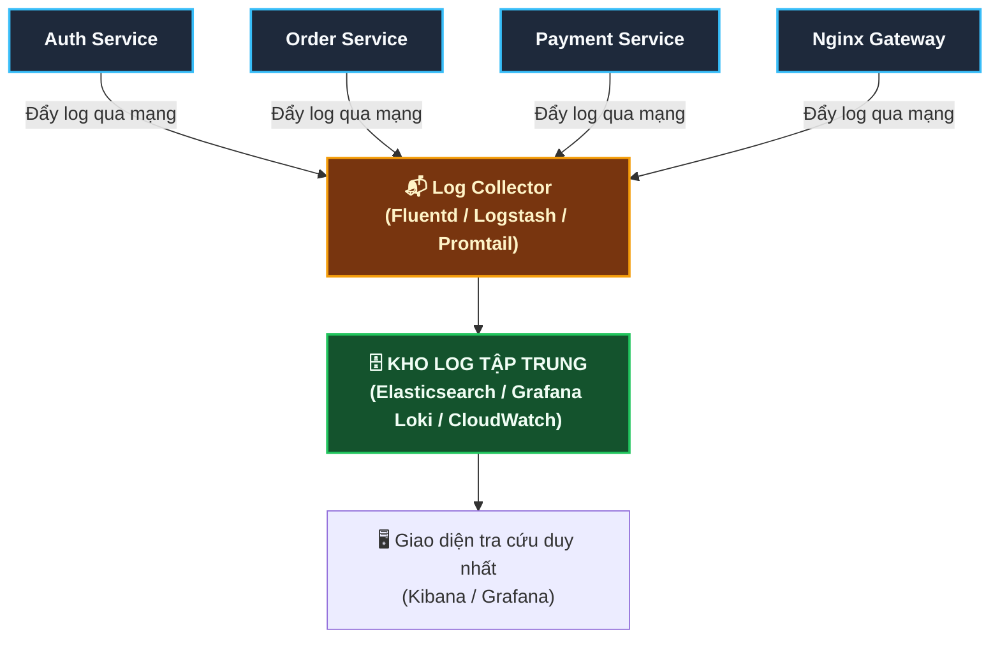

# 📊 API Security Checklist: Monitoring (Giám Sát & Phát Hiện Xâm Nhập)

Tài liệu này chi tiết hóa toàn bộ 5 chốt chặn an ninh thuộc nhóm **"Monitoring" (Hệ thống giám sát, cảnh báo và phát hiện xâm nhập)** trong bộ tiêu chuẩn **API Security Checklist** quốc tế:

```
┌────────────────────────────────────────────────────────────────────────┐
│                      API SECURITY: MONITORING                          │
├────────────────────────────────────────────────────────────────────────┤
│ [ ] 1. Use centralized logins/loggings for all services and components │
│ [ ] 2. Use agents to monitor all requests, responses, and errors       │
│ [ ] 3. Use alerts for SMS, Slack, Email, Kibana, CloudWatch, etc       │
│ [ ] 4. Ensure you aren't logging any sensitive data                    │
│ [ ] 5. Use an IDS and/or IPS system to monitor everything              │
└────────────────────────────────────────────────────────────────────────┘
```

> 🎯 **Châm ngôn kinh điển trong an ninh mạng:**  
> *"Có hai loại hệ thống: Những hệ thống **đã bị hack**, và những hệ thống **đã bị hack nhưng ban quản trị chưa hề hay biết**."*  
> Một hệ thống không có Monitoring cũng giống như một tòa nhà không có camera an ninh hay còi báo cháy — kẻ trộm vào lục lọi hàng tháng trời mà bạn không hề hay biết!

---

## 🗄️ 1. Use Centralized Loggings / Logins For All Services

### ❓ Vấn đề:
Trong kiến trúc Microservices hiện đại, bạn có thể có 20-50 dịch vụ khác nhau chạy trên hàng trăm container:
- Nếu mỗi service tự ghi log vào một file riêng trên từng máy chủ (`/var/log/app.log`), khi xảy ra sự cố bảo mật, kỹ sư **không thể SSH vào từng máy chủ để gõ lệnh `grep` tìm dấu vết**!
- Hacker có thể xóa lịch sử hoặc xóa chính file log đó để phi tang chứng cứ.

### 🛡️ Giải pháp: Tập Trung Hóa Toàn Bộ Log (Centralized Logging Stack)



- **Mọi sự kiện**: Lượt truy cập Nginx, query Database chậm, exception Backend, đăng nhập thất bại đều được gom về một mối duy nhất.
- Kỹ sư chỉ cần mở **Kibana** hoặc **Grafana** gõ một từ khóa (ví dụ User ID hoặc Trace ID) là thấy toàn bộ hành trình của gói tin đi qua mọi service trong vòng 1 giây!

---

## 🕵️ 2. Use Agents To Monitor All Requests, Responses, And Errors (APM)

Để biết hệ thống đang khỏe hay yếu, bạn cần cài đặt các **Monitoring Agents (Bộ thu thập số liệu tự động)**:
- **Công cụ hàng đầu**: **Datadog Agent, Prometheus + Grafana, New Relic, OpenTelemetry (OTel), Elastic APM**.

### 4 Chỉ số vàng (The Four Golden Signals) bắt buộc phải theo dõi:
1. **Độ trễ (Latency)**: Thời gian API xử lý một request (P95, P99). Nếu đột ngột tăng từ 50ms lên 5000ms -> dấu hiệu DB bị nghẽn hoặc đang bị tấn công DoS.
2. **Lưu lượng (Traffic / RPS)**: Số lượng request/giây. Nếu lúc 3 giờ sáng mà lưu lượng tăng vọt gấp 10 lần -> Dấu hiệu bị quét dò mật khẩu (Brute-force / Scraping).
3. **Tỷ lệ lỗi (Errors)**: Số lượng mã lỗi `4xx` (đặc biệt là 401, 403, 429) và lỗi `5xx`.
4. **Độ bão hòa tài nguyên (Saturation)**: Mức độ sử dụng CPU, RAM, Disk I/O và Connection Pool của Database.

---

## 🚨 3. Use Alerts For SMS, Slack, Email, Kibana, CloudWatch

Một hệ thống giám sát hoàn hảo sẽ **tự động đánh thức kỹ sư trực ca dậy** trước khi người dùng kịp phàn nàn!

```
[ Sự Cố Bất Thường ] ──> [ Monitoring Tool ] ──> KÍCH HOẠT QUY TẮC CẢNH BÁO
                                                               │
                             ┌─────────────────────────────────┴─────────────────────────────────┐
                             ▼                                                                   ▼
                 CẢNH BÁO MỨC TRUNG BÌNH (P2 / P3)                                   CẢNH BÁO KHẨN CẤP (P0 / P1)
                 • Tỷ lệ lỗi 404 tăng nhẹ                                            • Lỗi 500 tăng > 5% trong 3 phút
                 • 1 IP bị rate limit 429                                            • Database CPU > 95%
                 👉 Bắn tin nhắn vào kênh Slack / Telegram                           👉 GỌI ĐIỆN THOẠI & NHẮN SMS
                                                                                        (PagerDuty / Opsgenie / Twilio)
```

### Các kịch bản cảnh báo an ninh bắt buộc phải thiết lập:
- 🚨 **Cảnh báo dò pass**: Một địa chỉ IP nhận hơn **20 lỗi `401 Unauthorized` trong vòng 1 phút**.
- 🚨 **Cảnh báo xâm nhập dữ liệu**: API xuất dữ liệu khách hàng được gọi liên tiếp tải hơn **10.000 bản ghi**.
- 🚨 **Cảnh báo hạ tầng**: Dung lượng ổ cứng máy chủ vượt quá **85%**.

---

## 🙈 4. Ensure You Aren't Logging Any Sensitive Data (Chống Lộ Dữ Liệu Trong Log)

> 🛑 **NGUY CƠ CHẾT NGƯỜI:**  
> File log là nơi rò rỉ dữ liệu phổ biến số 1 trong các cuộc tấn công!  
> Rất nhiều lập trình viên bật chế độ `log.debug("Request body: {}", body)` và vô tình ghi thẳng **mật khẩu người dùng, số thẻ tín dụng, mã CVV, số CCCD và Token JWT** vào file log lưu vĩnh viễn trên máy chủ!

### 🛡️ Giải pháp: Bắt buộc dùng Mặt nạ dữ liệu (Log Masking)
Cấu hình bộ lọc tự động che giấu các trường nhạy cảm trước khi dòng log được ghi xuống ổ đĩa:

#### Ví dụ cấu hình Log Masking trong Java (Logback / Spring Boot):
```java
// Khi ghi log request:
String maskedEmail = email.replaceAll("(^[^@]{2})[^@]+", "$1***"); // namnguyen@gmail.com -> na***@gmail.com
String maskedCard = cardNumber.replaceAll("\\d(?=\\d{4})", "*");    // 4111222233334444 -> ************4444
```

* **Quy tắc tuyệt đối (Tiêu chuẩn PCI-DSS ngân hàng)**:
  - ❌ **CẤM TUYỆT ĐỐI GHI LOG**: Mật khẩu, mã OTP, số PIN, mã bảo mật CVV/CVC của thẻ ngân hàng.
  - 🔒 **Token / Khóa bí mật**: Chỉ ghi 6 ký tự đầu hoặc mã băm của Token, không bao giờ in nguyên chuỗi JWT ra log.

---

## 🛡️ 5. Use An IDS And / Or IPS System To Monitor Everything

Khi hacker bắt đầu dò quét hệ thống, bạn cần một "hệ thống radar" tự động phát hiện và đánh chặn:

```
┌──────────────────────────────────────────────┐       ┌──────────────────────────────────────────────┐
│        IDS (Intrusion Detection System)      │       │       IPS (Intrusion Prevention System)      │
│       "HỆ THỐNG PHÁT HIỆN XÂM NHẬP"          │       │        "HỆ THỐNG NGĂN CHẶN XÂM NHẬP"         │
├──────────────────────────────────────────────┤       ├──────────────────────────────────────────────┤
│ • Đóng vai trò như CAMERA AN NINH.           │       │ • Đóng vai trò như BẢO VỆ CÓ VŨ TRANG.       │
│ • Lắng nghe gói tin mạng, phân tích dấu hiệu.│       │ • Nằm trực tiếp trên đường truyền (Inline).   │
│ • Khi thấy tấn công: CHỈ BÁO CỘNG ĐỎ         │       │ • Khi thấy tấn công: LẬP TỨC CHẶN ĐỨNG GÓI   │
│   (Gửi cảnh báo cho Admin).                  │       │   TIN (Drop Packet) & KHÓA LUÔN IP HACKER!   │
└──────────────────────────────────────────────┘       └──────────────────────────────────────────────┘
```

### Các công cụ IDS / IPS thực tế theo từng tầng:
1. **Tầng Ứng dụng Web (WAF - Web Application Firewall)**:
   - **Cloudflare WAF, AWS WAF, ModSecurity**.
   - Chặn ngay lập tức các gói tin HTTP chứa mẫu tấn công SQL Injection, XSS, Path Traversal trước khi gói tin chạm tới Backend.
2. **Tầng Máy chủ (Host-based IDS - HIDS)**:
   - **Wazuh, OSSEC, Fail2ban**: Giám sát file hệ thống Linux, phát hiện file bị sửa đổi trái phép (File Integrity Monitoring - FIM) hoặc tài khoản bị brute-force.
3. **Tầng Mạng (Network IDS/IPS - NIDS)**:
   - **Suricata, Snort**: Quét lưu lượng mạng ở tầng gói tin (Packet level) để tìm mã độc hoặc botnet.

---

## 🎯 Bảng Đối Chiếu Nhanh 5 Tiêu Chí "Monitoring"

| # | Tiêu chí trong ảnh | Mối đe dọa ngăn chặn | Công cụ triển khai |
|---|---|---|---|
| 1 | **Centralized logins / loggings** | Khó điều tra khi bị hack, mất dấu vết | ELK Stack (Kibana), Grafana Loki, Fluentd |
| 2 | **Agents to monitor requests & errors** | Sập hệ thống âm thầm, nghẽn tài nguyên | Prometheus, Datadog Agent, OpenTelemetry |
| 3 | **Alerts (Slack, SMS, CloudWatch)** | Phát hiện muộn sự cố, downtime kéo dài | PagerDuty, Opsgenie, Telegram/Slack Bot |
| 4 | **Ensure no sensitive data in logs** | Rò rỉ mật khẩu, thẻ ngân hàng trong log | Log Masking regex, tuân thủ chuẩn PCI-DSS |
| 5 | **Use IDS / IPS systems** | Các cuộc tấn công mạng, zero-day, port scan | Cloudflare WAF, AWS WAF, Fail2ban, Suricata |
